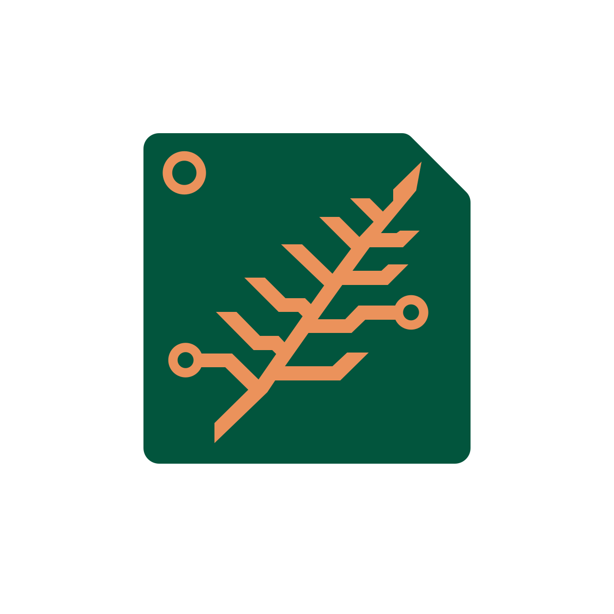
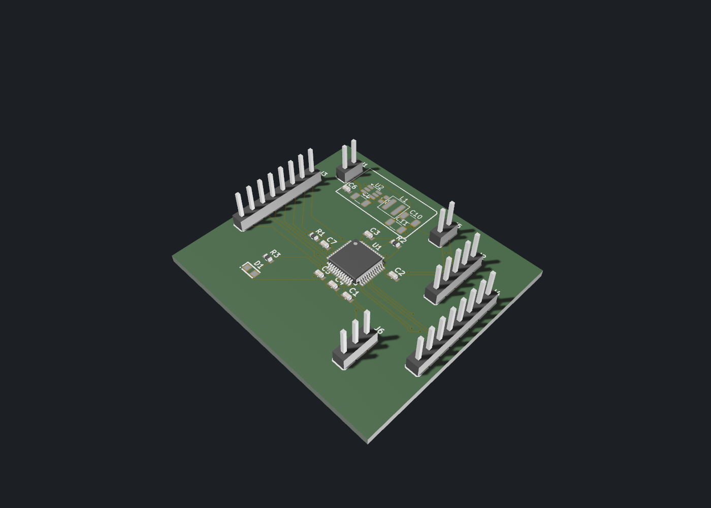

<p align="center">
  
</p>

<h1 align="center">Foilfern</h1>

<p align="center">
  <strong>Open-source PCB design in Rust for engineers and AI agents.</strong><br />
  Go from a design brief to an editable schematic, a routed board, and manufacturing files.
  Work in the Slint desktop editor, run checks from the command line, or let an agent drive the
  same project through MCP.
</p>

<p align="center">
  <a href="#build-from-source">Build from source</a> ·
  <a href="#ai-agents-over-mcp">Connect an agent</a> ·
  <a href="#stm32g474-routing-example">Routing example</a> ·
  <a href="docs/status.md">Project status</a>
</p>

<p align="center">
  
</p>

*Codex designed this STM32G474 development board from scratch in Foilfern
through MCP. It created the schematic, placed the components, and routed
the entire PCB, including the 5 V to 3.3 V buck converter. Foilfern rendered
the finished layout in 3D.
[Read the board and routing experiment](docs/mcp-routing-reliability.md#stm32g474-with-buck-converter-and-bottom-gnd-pour).*

## What works

- **Schematics.** Install libraries, pick parts and footprints, place symbols,
  connect pins, and run electrical rule checks (ERC).
- **PCB layout.** Set the board outline and rules, place components, and edit
  traces, vias, and copper pours. Inspect the board in the interactive 3D view.
- **Routing.** Compare candidates from the same board snapshot by new design
  rule check (DRC) errors, open connections, via count, and trace length.
  Preview the changes and apply the chosen candidate as one undo step.
- **Manufacturing.** Run ERC and DRC, save an editable LibrePCB project, and
  export Gerber, Excellon, BOM, and pick-and-place files.

## Build from source

From the repository root, use a recent stable Rust toolchain. On Debian or
Ubuntu, [the setup script](scripts/cloud-setup.sh) installs the development
dependencies and prepares the upstream LibrePCB checkout used by the tests.

```sh
cargo run --locked -p librepcb-app -- --project /path/to/board.lpp
cargo run --locked -p librepcb-cli -- open-project /path/to/board.lpp --erc --drc
```

Add `--tab board3d` to the desktop command to open the 3D view.
[3D controls and graphics requirements](crates/librepcb-render3d/README.md)

## AI agents over MCP

Foilfern exposes project editing, validation, and exports through the
[Model Context Protocol](https://modelcontextprotocol.io/). The standalone
server runs headless. With the embedded server, you can watch the agent work
in the open project and undo its edits from the desktop editor's history.

Install the standalone server from the checkout.

```sh
cargo install --locked --path crates/librepcb-mcp
```

Register it with your MCP client. The server opens the workspace you pass and
creates it if needed.

**Codex**

```sh
codex mcp add foilfern -- librepcb-mcp --workspace "$HOME/LibrePCB-Workspace"
```

**Claude Code**

```sh
claude mcp add --transport stdio foilfern -- librepcb-mcp --workspace "$HOME/LibrePCB-Workspace"
```

For other clients, configure a stdio server with the command `librepcb-mcp`
and arguments `--workspace` and the absolute workspace path. To connect to an
open desktop project, launch the editor with `--mcp` and point a Streamable
HTTP client at `http://127.0.0.1:8766/mcp`.

Try a first design brief.

> Create a 3.3 V LED indicator board with a two-pin power header. Select an LED
> and series resistor, draw the schematic, and place the parts on a two-layer
> board. Run ERC and prepare a routing candidate. Show me the preview and DRC
> result before applying it, then save the project and export the fabrication
> files.

[MCP board workflow](docs/mcp-board-workflow.md) · [Server design](docs/mcp-design.md)

## STM32G474 routing example

In a recorded run on an earlier version of the STM32G474 board, the built-in
router tried three orders from the same placement, design rules, and 57 open
connections.

| Initial routing order | Open connections | New DRC errors | Vias | Total trace length |
| --- | ---: | ---: | ---: | ---: |
| Constrained pads first | **0** | 0 | **47** | 765.49 mm |
| Longest connections first | **0** | 0 | 56 | 741.53 mm |
| Shortest connections first | 1 | 0 | 40 | 719.54 mm |

The chosen route closed every connection with nine fewer vias than the other
complete candidate. It was previewed, applied, saved, and reopened. Upstream
LibrePCB reported two pre-existing silkscreen warnings.
[Routing settings and results](docs/mcp-routing-reliability.md#stm32-comparison-of-initial-orders)

## LibrePCB compatibility

Foilfern started as `librepcb-rs`, an independent Rust implementation of
[LibrePCB](https://github.com/LibrePCB/LibrePCB). It aims to preserve
interoperability with native LibrePCB projects and libraries. Tests cover file
round trips, migrations, checks, and selected exports against upstream
fixtures and `librepcb-cli`.
[Compatibility and known gaps](COMPAT.md) · [Roadmap](docs/roadmap.md)

## Contributing

[The porting guide](docs/porting-guide.md) covers the upstream reference and
test setup. The default upstream checkout is `../LibrePCB`; set
`LIBREPCB_UPSTREAM_DIR` if yours is elsewhere. Set `LIBREPCB_CLI` to an
upstream CLI binary to enable reference comparisons.

```sh
cargo fmt --check
cargo clippy --workspace --all-targets -- -D warnings
cargo test --workspace
```

[Project model and undo](docs/project-model-design.md) ·
[Routing service](docs/routing-service-design.md)

## License

GNU General Public License v3.0 or later. [Full license](LICENSE.txt).
The original design, file formats, and reference implementation are the work
of the upstream LibrePCB developers.
