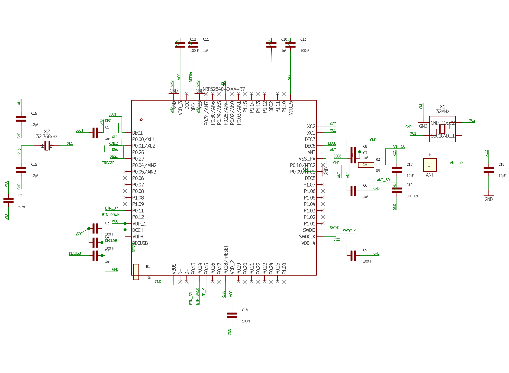
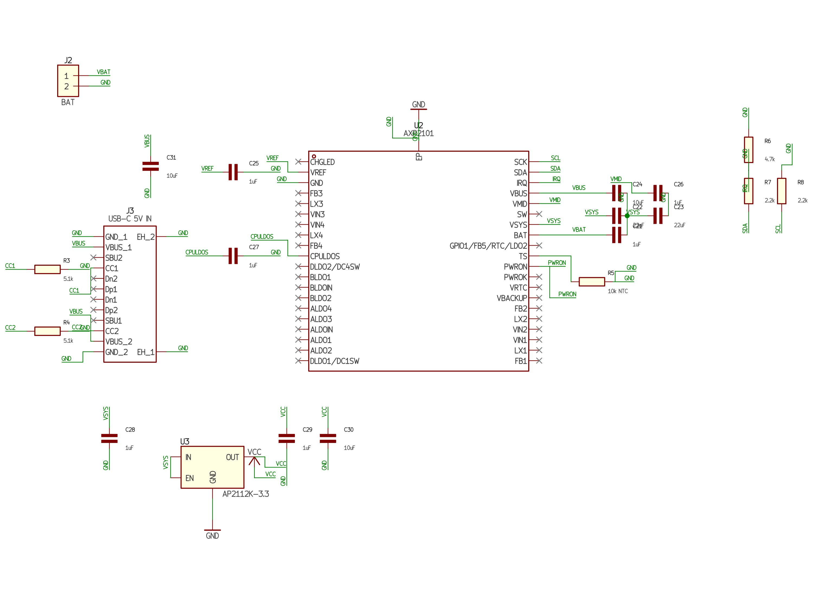
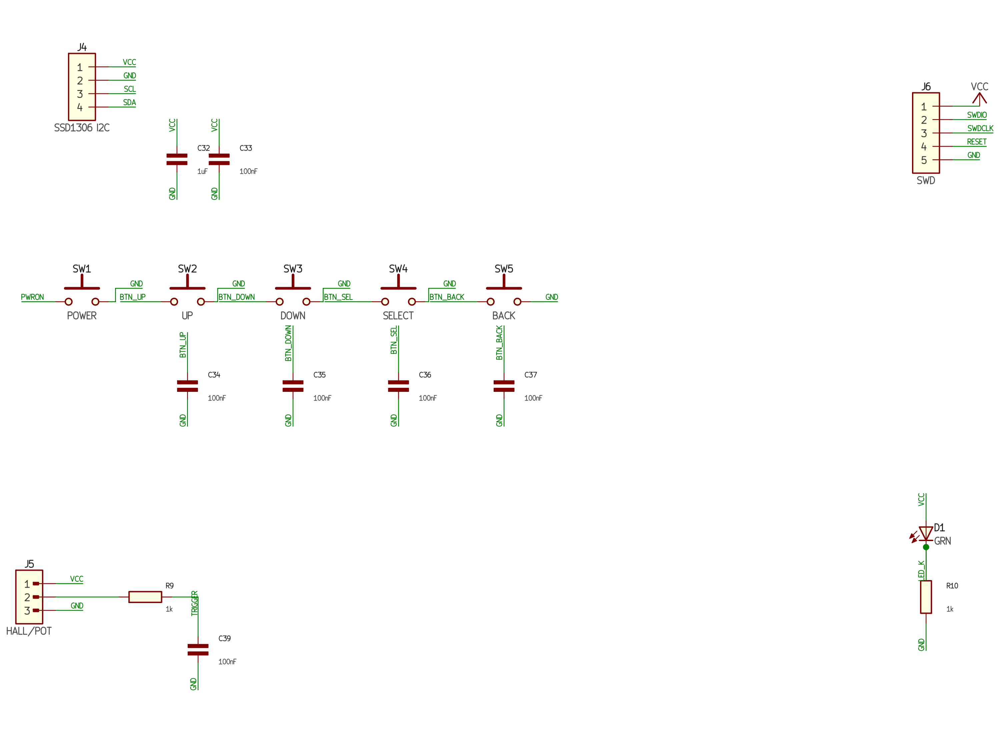

# Skateboard remote schematic trial

## Outcome

**Failed acceptance.** The independent run produced a saved 73-component,
38-net, three-page schematic. Its final circuit has electrical errors and
37 reported annotation overlaps. This larger case establishes a limit of the
preceding passive-circuit trials.

The task reused the user's electric-skateboard remote request for a bare
nRF52840, PMIC, SSD1306 I2C solder contacts, buttons including a PMIC power key,
and a Hall-sensor/potentiometer trigger interface. AXP2101 replaced the earlier
AXP2102 name, as in the previous experiment. Scope was the schematic stage.

The agent used DeepSeek `deepseek/deepseek-v4.1-flash-1017` through ACP with the
complete 101-tool catalog. Foilfern source, previous circuit projects and earlier
trial artifacts were hidden. It received an empty project and a copy of the
installed workspace libraries, including existing acquired parts. Documentation
retrieval and further part acquisition were available. The supplied binary was
a clean release build of `02e5637`, API 63, SHA-256
`8fc07f008bf89fc162c50dd118f8a2b760810dcad20b9c87f5d80f68f41c9baa`.

## Time and tokens

| Measurement | Task | Separate feedback |
| --- | ---: | ---: |
| Wall time | 692.86 s | 8.28 s |
| Uncached input tokens | 89,690 | 75 |
| Cache-read input tokens | 6,597,760 | 157,440 |
| Output tokens | 73,288 | 494 |
| Total reported tokens | 6,760,738 | 158,009 |

The task used 82 API messages and 86 built-in tool calls, including terminal
commands containing batches of Foilfern calls. The ceiling was 180 model turns
and 45 minutes. It completed its response while acknowledging remaining layout
work. The separate feedback turn also identified DeepSeek. The runner and its
descendants were restricted to two CPU cores with nice level 10.

The agent spent calls on blocked Nordic documentation downloads, initial
placement, a full circuit rebuild and subsequent label edits. Its report
acknowledged that the Nordic support circuitry had not been verified in this
session. Independent review obtained Nordic's downloadable reference archive.

## Electrical findings from saved read-back

The final project was copied after the run, reopened in an independent process
and read through `component_list`, `netlist`, `schematic_get`, `schematic_review`,
`erc_run` and `render`. The following findings concern the saved circuit.

1. **SDA/SCL pull-up intent was lost.** R7 connects SDA to GND and R8 connects
   SCL to GND. Both have value 2.2k. The MCU, PMIC and display do share the
   intended SDA/SCL net memberships. The resistor connections prevent the
   intended idle-high I2C bus. AXP2101 specifies pull-ups for its serial pins.
   [AXP2101 manufacturer datasheet, pages 8–9](https://datasheet.lcsc.com/datasheet/pdf/4f32bb3c83a61e426b4e09c536b24324.pdf?productCode=C3036461)
2. **IRQ and reset bias are incorrect.** R6 connects IRQ to GND, although
   AXP2101 IRQ is open-drain and its reference connection uses a pull-up.
   R1 connects RESET to GND. The agent's notes describe both as pull-ups.
   [AXP2101 manufacturer datasheet, page 8](https://datasheet.lcsc.com/datasheet/pdf/4f32bb3c83a61e426b4e09c536b24324.pdf?productCode=C3036461)
3. **The LED path has no series current-limiting resistor.** D1.A is on VCC.
   D1.C and MCU P0.15 share LED_K. R10 connects LED_K to GND. When the GPIO
   sinks LED current, that current bypasses R10. The notes describe an active-low
   LED with a 1k series resistor. [Saved netlist](netlist.json)
4. **nRF52840 support circuitry differs materially from the selected supply
   configuration's reference.** The agent used 1uF for every DEC capacitor,
   separated DEC4 and DEC6, and connected DCCH to VCC. Nordic's QIAA LDO/VDD
   reference joins DEC4/DEC6, leaves DCCH open and specifies distinct DEC
   capacitors. The generated antenna path uses 0R and a DNP shunt in place of
   the reference matching network. These choices have no verified replacement
   design evidence in the run.
   [Nordic QIAA reference archive, variant 3 schematic](https://nsscprodmedia.blob.core.windows.net/prod/software-and-other-downloads/reference-layouts/nrf52840qiaareflayoutv10.zip)

The final generated `case/work/gen2.py` explicitly assigns R1.1, R6.2, R7.2 and
R8.2 to GND. It also explicitly assigns R10.1 to GND and D1.C/R10.2/MCU P0.15
to LED_K. The submitted circuit definitions contain these mistakes. The returned
netlist agrees with those definitions. The final design notes contradict the circuit.

The AP2112K housekeeping rail is a deliberate attempt to avoid reliance on
AXP2101's customised regulator defaults. The datasheet lists default regulator
voltages and startup sequence as customised. That choice addresses one genuine
startup uncertainty. It does not establish correctness of the remaining circuit.
[AXP2101 manufacturer datasheet, pages 18–22](https://datasheet.lcsc.com/datasheet/pdf/4f32bb3c83a61e426b4e09c536b24324.pdf?productCode=C3036461)

## Readability findings

| Sheet | Annotation overlaps |
| --- | ---: |
| Main | 29 |
| Power | 7 |
| UI | 1 |

The MCU sheet has overlapping pin/net captions and a congested decoupling
cluster. Some labels cross symbol bodies. An independent geometry comparison
also found three positive-length collinear overlaps between wires on different
nets on Main. For example, XL1 and XL2 share a drawn horizontal run over
3.81 mm. ANT_50 and GND also share a drawn run. The native net identities remain
separate, creating misleading graphical connections. Those findings are stored
in `review.json`.

On UI, neighbouring button-net stubs and labels make unrelated nets appear
nearly continuous at overview scale. The agent judged Power and UI legible;
the independent review still found annotation conflicts on both pages.

### MCU

### Power

### Interfaces

## What ERC established

ERC returned zero errors and warnings with `outcome:partial`. Its coverage
explicitly reports `datasheet_verified:false`, `power_sources_checked:false`
and `pin_role_compatibility_checked:false`. The acquired nRF52840 and AXP2101
parts expose passive source pin roles with metadata gaps. This result covers
native structural checks. It did not validate the intended pull-ups, LED
current limiting or reference circuitry.

The test therefore failed both visual and electrical acceptance while its
structural ERC findings were empty. The preceding six small passive-circuit
successes provide limited evidence about large imported IC workflows.

## Preserved evidence

- [Original task and full catalog prompt](prompt.txt)
- [Agent's final answer](answer.md)
- [Agent's design notes](design-notes.md)
- [Detailed tool feedback](feedback.md)
- [Metrics, exact resistor connections and annotation reports](review.json)
- [Complete saved netlist](netlist.json)

The standalone run and native project remain under
`/home/okhsunrog/tmp_zfs/codex_tmp/foilfern-remote-schematic-acp/`.
Open `case/project/Esk8_Remote.lpp` for the generated native project. The complete
ACP events, native Claude transcript, submitted generators and intermediate
batch results are retained there. Independent read-back and manufacturer
reference files are under
`/home/okhsunrog/tmp_zfs/codex_tmp/foilfern-remote-schematic-review/`.

The external model's files above are preserved as returned. Some feedback
proposals require separate verification against existing capabilities.
