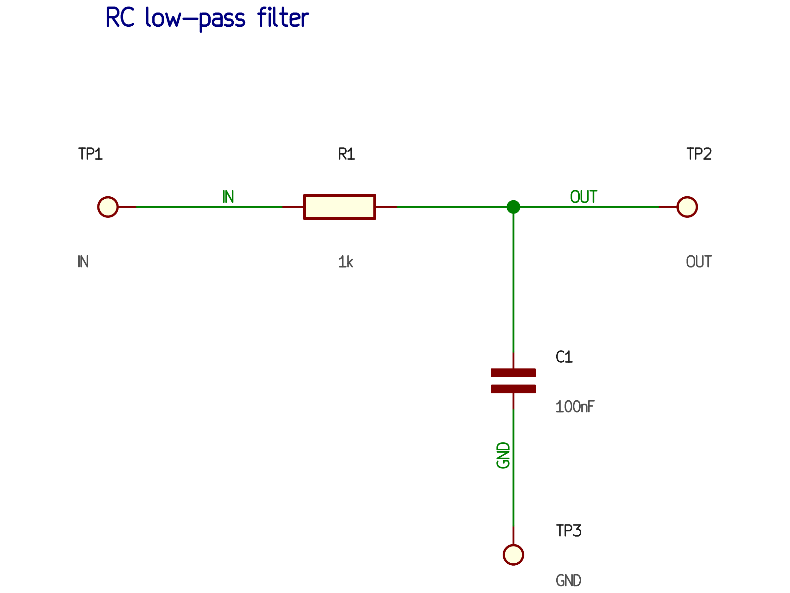
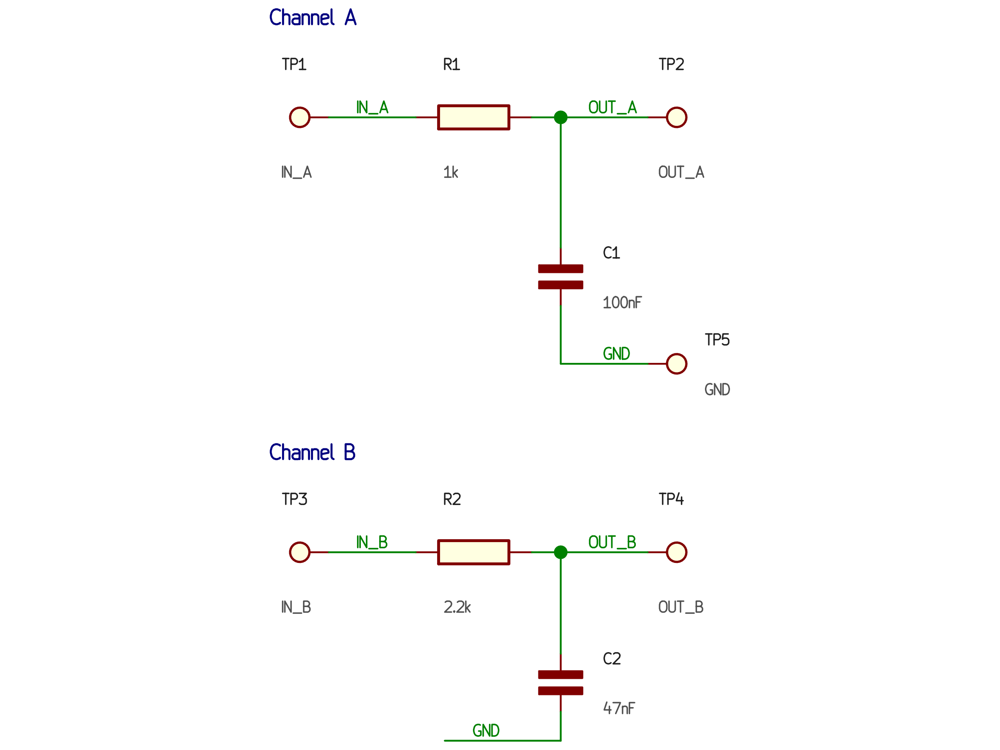

# Small schematic composition through ACP

Measured on 2026-11-16 with DeepSeek
`deepseek/deepseek-v4.1-flash-1017`, Claude Code 2.1.322, ACP adapter 0.107.0 and
protocol SDK 2.7.0. The final six runs used a release snapshot whose source changes were committed
as `ab6d8f9`, API 63.
Each began in a fresh session with an empty native schematic and fixed library
parts. Source checkouts were hidden by Bubblewrap. The agent received all 101
tool descriptions, complete schema access and the binary's starting instructions.
The catalog, embedded guide and example were its onboarding material.

All six final sessions completed. Independent reopen checks found the requested
component counts, resistor/capacitor values, exact pin-to-net memberships and
local physical wiring. Each reported zero ERC findings and zero annotation
overlaps. Image review found readable circuits, horizontal component captions,
visible branch junctions and distinct channel blocks. The second divider used
an overlong title and explanatory note. The second two-channel layout used more
whitespace. The pictures preserve those variations.

The local Claude configuration blocked MCP server registration. ACP controlled
the agent while it used Bash, Read and Write with Foilfern's local CLI. The
model sometimes inspected native project-library `.lp` files for pin geometry.
Those files are part data. The recorded tool calls contain no reads of Foilfern
implementation source. Trial fixtures and private Claude state shared a trial
root, so filesystem access to earlier trial artifacts was possible. The recorded
runs used their own case files, the supplied catalog and library data.

## Build provenance

The intermediate candidate records commit `5429325` with a clean tracked tree.
The final measured snapshot was compiled before its follow-up changes were
committed as `ab6d8f9`. Its embedded build metadata correctly records HEAD
`5429325` with `tracked_source_state:"dirty"`. The tables identify the
committed source snapshots. `results.json` records both that mapping and the
actual embedded metadata, along with exact binary hashes. The original release
baseline records `82a9efd` with a clean tracked tree.

After committing this report, the operational release binary is rebuilt from a
clean tree and checked with the RC document replay. Its actual metadata and hash
are retained at the artifact root in `clean-build.json`. The measured candidate
binaries stay available separately.

## Measurements

Task times exclude the separate feedback turn and ordinary ACP startup. The
first two failed baseline times are estimated by subtracting startup from total
session time because the initial harness lost the final error response. Tokens
are summed across task API messages, with cache reads shown separately. Counts
include image and tool-response input and the model's reported output usage.
They express repeated context processing across calls.

| Build / case | Task seconds | Uncached input | Cache-read input | Output | API messages | Outcome |
| --- | ---: | ---: | ---: | ---: | ---: | --- |
| `82a9efd` divider | ~192.8 | 41,516 | 1,198,976 | 21,324 | 40 | Turn limit |
| `82a9efd` RC | ~130.8 | 42,059 | 1,452,800 | 22,912 | 40 | Turn limit |
| `82a9efd` dual RC | 191.6 | 41,821 | 1,379,712 | 24,449 | 40 | Turn limit |
| `5429325` divider | 125.2 | 95,186 | 974,336 | 17,818 | 35 | Completed |
| `ab6d8f9` divider 1 | 115.3 | 63,839 | 461,952 | 15,682 | 17 | Completed |
| `ab6d8f9` divider 2 | 101.6 | 37,843 | 747,648 | 13,097 | 27 | Completed |
| `ab6d8f9` RC 1 | 98.2 | 29,395 | 473,472 | 10,726 | 22 | Completed |
| `ab6d8f9` RC 2 | 74.3 | 29,206 | 494,208 | 11,801 | 23 | Completed |
| `ab6d8f9` dual RC 1 | 247.8 | 36,039 | 1,341,952 | 28,281 | 35 | Completed |
| `ab6d8f9` dual RC 2 | 178.9 | 54,698 | 930,432 | 21,394 | 26 | Completed |

The saved baseline circuits also passed the native checks. Each agent task hit
the model-turn ceiling before finishing its workflow and final report. The RC
baseline retained vertically rotated test-point captions. The two-channel
baseline placed the ground test point far from its circuits.

The divider and single RC tasks finished faster in the final runs and used less
aggregate input. Uncached input increased in one final divider run. The first
final dual-RC run took longer than the baseline's time to failure and produced
more output tokens. Its second run finished in 179 seconds. Completion and
readability improved across the small corpus. Uniform speed or token reduction
is unproven.

There is one baseline run per topology and two final runs per topology. The
first divider's part manifest supplied component identities alone; later cases
also supplied device and variant identities. Missing unused variant dependencies
in the initial seed were corrected before the RC and dual-RC baselines. These
fixture differences and stochastic model behavior limit causal performance
claims. Final repeats used the same completed seed and part manifest.

Feedback was measured in a separate turn. All six final task and feedback
responses identified DeepSeek. Two earlier feedback-recovery attempts selected
Opus through the copied Claude model setting. Their output and cost are
excluded from the DeepSeek task measurements. The harness now explicitly selects
the model and checks response metadata. Three initial zero-tool MCP setup
failures are retained separately under `baseline/harness-failure-*`.

## Changes supported by the trials

Automatic `WireGroup` routing previously drew the first pair before planning
later branches. The new same-net wire then obstructed subsequent routes. The
command now plans the group, splits shared runs and orthogonal intersections,
and delegates native junction creation to the existing explicit-path command.
A three-pin branch regression covers repeat application and undo/redo.

Route planning previously treated a symbol and its captions as one enclosing
rectangle. A caption beside a capacitor could block clear space above its pin.
Symbol bodies and individual text rectangles are now separate obstacles. The
host-side RC document replay exercises both corrections. Agent runs exercised
explicit paths and automatic local groups.

`foilfern-mcp tools` now reads the actual registered catalog, including schemas
and server instructions. `guide schematic` and `guide rc-lowpass` expose the
embedded workflow and worked document. MCP resources expose the same content.
Starting instructions and creation-tool descriptions direct schematic work to
the guide. It covers composition, initial fields, local wires, image review and
saving. CLI discovery works without a workspace.

The first successful divider still wasted calls on guide naming and `batch
@file`. Follow-up `ab6d8f9` accepts both `batch file` and `batch @file`, accepts
resource-name guide aliases and documents JSONL envelopes and preview-result
references. The two final divider runs used 20 and 29 actual built-in tool
calls, compared with 41 in the first successful candidate. API-message counts
in the table differ because one model response can issue several tool calls.

Focused editor, CLI and stdio acceptance passed, including existing RC design
coverage. Clippy passed for the affected editor/MCP crates and all their targets
with warnings denied. Both measured candidate binaries were compiled in release
mode with two Cargo jobs and CPU affinity restricted to cores 0 and 1. The final
runner also restricts its descendants to those cores. Full-workspace acceptance
and upstream LibrePCB CLI validation were outside this measurement.

## Feedback interpretation and remaining friction

Detailed model feedback is retained in [feedback.md](feedback.md). Actual calls
support the following observations.

- Agents repeatedly passed `symbol_variant` UUIDs to `library_element` as symbol
  UUIDs. The failed requests identify variant objects. A component query exposes
  its gate's actual symbol UUID, and subsequent correct queries succeeded.
  The distinction needs stronger presentation. The feedback does not establish
  a project-symbol lookup defect.
- Explicit waypoints coincident with pins are rejected with a request to use
  the pin name. Several agents recovered after a failed preview. The workflow
  should make that rule easier to discover before constructing paths.
- Automatic net labels follow wire orientation. Agents wanting horizontal
  labels introduced horizontal ground stubs or explicit paths. The schema and
  guide leave room for clearer automatic-label behavior.
- A preview belongs to its server session. Inspecting an image after a
  preview-only CLI process exits led agents to repeat the preview inside their
  apply batch. That duplicate work remains a local-CLI workflow cost.
- Revisions and undo history are session-local. Reading revision zero after a
  saved CLI edit confused several agents.
- Caption overlap checks assess geometry. Title verbosity, redundant net/value
  text and excessive block spacing still required image review.

Some feedback proposed batch result forwarding, which already exists and was
used successfully. One attempted `$ref` pointed to a filename; the error
correctly requested an earlier-result index and JSON pointer. Such proposals
were checked against actual calls and the implementation before choosing changes.

## Saved examples

[Divider run 1](divider-1.png), [divider run 2](divider-2.png),
[RC run 1](rc-filter-1.png), [RC run 2](rc-filter-2.png),
[dual RC run 1](dual-rc-1.png), [dual RC run 2](dual-rc-2.png).

## Reproduction and evidence

[README.md](README.md) describes the ACP runner, isolated state, fixture setup
and independent checks. [results.json](results.json) contains exact token
counts, build identity, binary and prompt hashes, session identifiers, feedback
measurements and native read-back reports. `scenarios.json`, `parts.json` and
`prompt-prefix.txt` retain the frozen task material. `prepare.py` regenerates
prompts with the chosen binary's catalog.

The complete local artifact root is
`/home/okhsunrog/tmp_zfs/codex_tmp/foilfern-schematic-trials/`.
It retains native saved projects, the seed, catalogs, per-case prompts,
ACP events, native Claude transcripts and build logs. The temporary adapter
installation is `/home/okhsunrog/tmp_zfs/codex_tmp/foilfern-claude-pilot/acp/`.
Private state and installed library copies remain in those local directories.
The original and both measured candidate binaries are retained separately.
