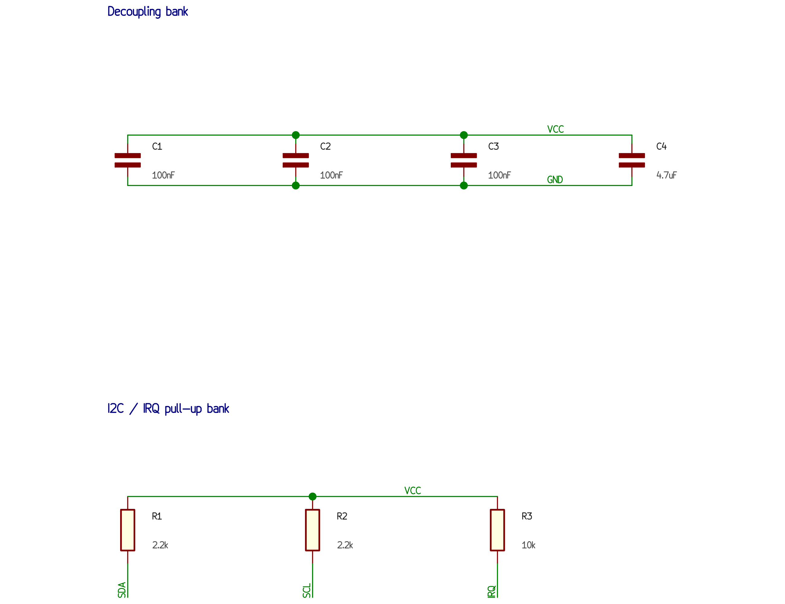
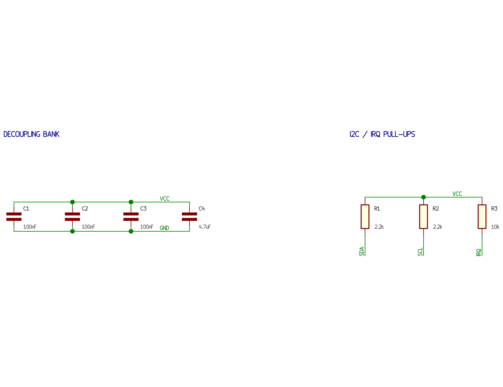
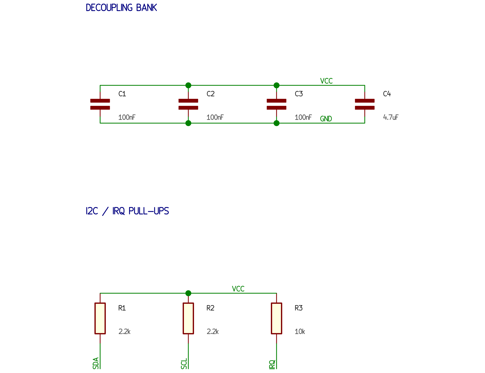
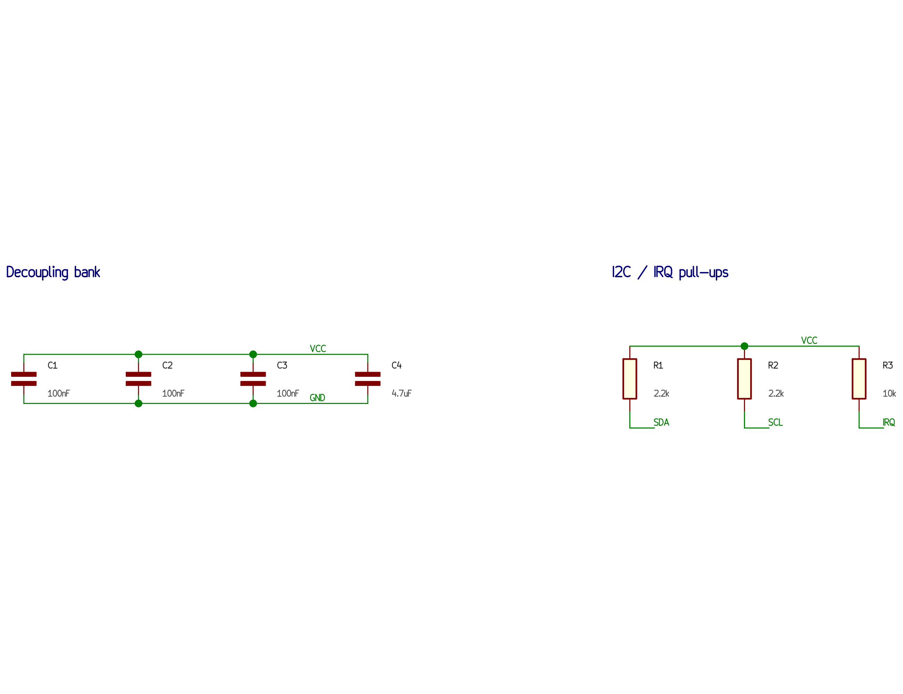

# Bounded schematic group trials

## Scope

The original large remote-control trial added component batches with manually
chosen coordinates. Its three creation batches contained 30, 24 and 19 parts,
with no `block` placement. A first follow-up used `wire_groups` and still omitted
`block`. It finished with one independently detected annotation overlap.

The workflow now creates new `add_components` members inside a bounded `block`,
measures their rendered geometry and then draws their local `wire_groups`.
Name/value fields, pin captions, existing labels, notes and no-connect markers
participate in placement. Managed existing routes can be replaced after a block
move. Replaying an unchanged document produces an empty diff.

The focused trial requests exactly four capacitors and three pull-ups in two
titled banks. Values, pin memberships and native part identities are fixed.
The prompt explicitly requests bounded block creation and automatic local
wiring. It tests execution of the documented workflow. Datasheet research and
part discovery are outside this scenario.

## Isolation and measurements

Every run starts with an empty native project, the same installed-library
snapshot, the complete 101-tool description catalog and access to full schemas
and embedded guides. Source directories, previous projects, previous trial
artifacts and conversation memory are hidden by a mount namespace. Each trial
has a fresh client state. All processes run on CPU cores 0 and 1 at nice level
10. Runs are sequential, with a ten-minute task deadline.

The final trial binary is the clean Cargo release build of `9e89cad`, API 63,
SHA-256 `131309b983f9af43d330e5a0affb162bdb0f76bbf8d389b06028a7848e946ec4`.
Its normal build path was `target/release/foilfern-mcp`. Each trial receives a
frozen copy under its own `bin/foilfern-mcp`. The collector checks that copy
against the fixture hash and checks the actual model IDs in native transcripts.

DeepSeek and Qwen use Claude Agent ACP 0.107.0 and SDK 2.7.0 through Ori.
Sol and Terra use Codex CLI 0.169.0 with high reasoning effort. Foilfern calls
use the CLI handlers shared with MCP. The local Claude policy prevented direct
MCP registration. These client differences and a single run per model limit
cross-model conclusions.

Task counters include cached input. Uncached input, cache-read input and output
are retained separately in `measurements.json`. Reasoning tokens are already
included in output. Codex feedback counters are cumulative across resume, so
the collector subtracts the task counters. Feedback is a separate measured
phase. ACP task time excludes startup, whose end-to-end value is also recorded.

## Focused results

| Model | Task seconds | Uncached input | Cache read | Cache write | Output | Total | Acceptance |
| --- | ---: | ---: | ---: | ---: | ---: | ---: | --- |
| DeepSeek V4.1 Flash 1017 | 99.19 | 85,620 | 467,712 | 0 | 14,581 | 567,913 | Pass |
| GPT-6.1 Sol | 171.33 | 60,600 | 493,440 | 0 | 6,175 | 560,215 | Pass |
| GPT-6.1 Terra | 129.95 | 40,327 | 858,368 | 0 | 4,342 | 903,037 | Pass |
| Qwen4 Max | 344.59 | 65,837 | 674,304 | 53,737 | 14,805 | 808,683 | Pass |

Independent saved-project read-back confirmed exact net memberships and values,
seven components, supply pins above the passives, distinct local VCC rails,
signal labels and zero annotation or different-net collinear wire overlaps.
Independent re-preview of both final creation documents returned an empty diff
for every model. All four used `block` for both banks and automatic multi-pin
`wire_groups`. Qwen replaced its first pull-up bank and used explicit relative
paths for horizontal singleton signal labels in its final bank.

DeepSeek's preceding run on `2c83e0b` reached the ten-minute deadline after
591.95 task seconds, 28 terminal calls and 752,462 reported tokens. It failed
the first bank's automatic route and never completed the circuit. The final
run used 24 calls and completed. Sol's preceding run succeeded in 212.03 seconds
and 1,014,693 tokens after manual field-offset workarounds. Its final run used
20 calls and encountered no tool errors. Sol's earlier launcher also inherited
a virtual-environment variable that was cleared for the final trials.

The normalized task prompt hash is identical across the two revisions and all
four final clients. Embedded documentation and runtime behavior changed. These
single observations show removal of a concrete failed workflow. They leave
run-to-run variance and broader task coverage unmeasured.

Qwen's copied client catalog initially omitted the requested model and rejected
selection before any task request. The public OpenRouter model list confirmed
the ID. Its isolated client cache was refreshed with that entry, and the actual
task and feedback transcripts both identify `qwen/qwen4-max`. There was one
paid Qwen task.

### DeepSeek

### Sol

### Terra

### Qwen

## Regressions found through the trials

- The first DeepSeek bank request failed to find a VCC route around the
  capacitor name/value rows. The router supported straight and one-corner
  paths. Bounded two-corner channels now route this exact saved request without
  editing its input. Native replay is clean and idempotent.
- Initial no-connect markers were added after measuring a new block. Replaying
  a two-resistor document shifted both symbols by 2.54 mm. Notes and markers
  now exist before packing, and that exact request replays with an empty diff.
- Existing automatic routes stretched during a block move and obstructed their
  replacement. All affected managed routes are removed before redrawing.
- A group-only connection cannot represent a singleton signal end. The guide
  and error now explain `assign_only:false` for components with such ends.

Focused regression coverage includes create, wire, replay, move, undo,
annotation-aware packing and atomic rejection. The editor suite passed 112
tests. The MCP suite passed 112 tests with two ignored. Focused Clippy with
warnings denied and formatting checks passed.

## Feedback that still needs product work

The final runs identify vertical signal-end labels and excessive
space between bank titles and circuitry. Overlap detection does not assess
compactness or title proximity. The images below preserve those limitations.

Other observed friction includes large argument schemas, session-local preview
IDs and revisions, and image framing. Terra also invoked the CLI concurrently
against shared native project locks and received lock-file removal errors.
Its sequential calls completed. These observations are retained in the
individual feedback files.

DeepSeek's earlier claim that `tools design_preview` ignored filtering was
checked against its frozen binary. The full catalog contained 101 tools and
348,908 bytes. The filtered response contained one tool and 55,415 bytes.
Filtering worked. Existing initial component fields also intentionally remain
initial-only on replay, and `batch --continue-on-error` already existed.

## Preserved circuit relayout

The saved original 73-component, 38-net, three-page circuit was relaid out three
times from the same snapshot with the final release binary. All runs preserved
the complete returned netlist exactly. Independent read-back found zero
annotation overlaps and zero positive-length collinear overlaps between wires
on different nets on Main, Power and UI.

The old release's whole-page tidy left five annotation overlaps on Main and two
on Power. The original agent-produced pages had 37 total. The new command also
adjusts pin-caption artwork of one embedded library symbol shared by its project
instances and reports that operation explicitly. Circuit assignments remain
equal. Existing electrical errors recorded in the original report remain in
this preserved circuit.

Relayout plus read-back and rendering took 0.880, 0.523 and 0.527 seconds. The old
release control took 0.612 seconds. These short runs establish repeatability
and retain raw timing evidence. They provide limited performance evidence.
Whole-page tidy also leaves scattered passives and long label-driven
connections. The bounded creation trial addresses local functional groups.

## Evidence and replay

Each model directory contains its final creation documents, independent
acceptance, replay verification, render and detailed feedback. The common
`prompt.txt` substitutes `@TRIAL_ROOT@` for the isolated case root. Full
counters, binary identities and earlier failed-run measurements are in
`measurements.json`. `preserved-relayout/results.json` records the native
relayout checks and timings.

Full native projects, events, submitted scripts and model transcripts are kept
under `/home/okhsunrog/tmp_zfs/codex_tmp/foilfern-schematic-block-comparison-v2/`.
The preceding run is in the sibling `foilfern-schematic-block-comparison/`.
The original-circuit replay artifacts are in `foilfern-layout-repair/`.

Run `uv run python docs/benchmarks/schematic-blocks/verify.py <trial-root>` to
reopen a saved seven-component trial and repeat the independent audit.
`collect.py <trial-root>` checks the frozen binary, verifies transcript model
IDs and normalizes the retained runtime counters. These scripts require the
existing trial fixture layout with `bin`, `workspace` and `case` directories.

